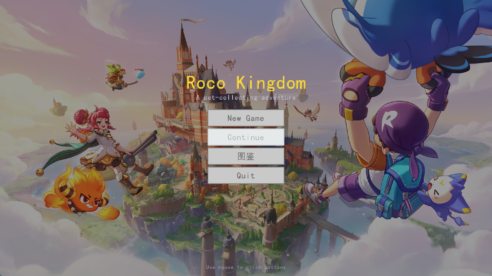

# 洛克王国 3D · Roco Kingdom 3D

一个用 **C (GNU17) + raylib 6.0** 从零实现的洛克王国风格 **3D 宠物收集回合制 RPG**。程序化无限地形、第三人称探索、8 种宠物 / 16 招式 / 6 属性、图鉴、任务、商店与存档系统。



## 功能特性

- **程序化无限地形** — 4 层 value-noise 生成 512×512 网格，同一坐标永远生成相同地形与训练师。
- **第三人称探索** — 镜头相对移动、台阶攀爬、墙壁阻挡、悬崖边缘保护、斜坡速度调节、冲刺体力。
- **回合制战斗** — 属性克制、状态效果、PP 耗尽挣扎、先手判定、捕捉与逃跑，含冲刺/挤压/震动/粒子等攻击动画。
- **宠物系统** — 8 种宠物、16 种招式、6 种属性，种族值 × 等级计算属性。
- **图鉴** — 宠物 / 道具 / NPC / 机制 4 个标签页，宠物卡片可点击查看详情与立绘。
- **NPC 与任务** — 8 名固定 NPC（训练师 / 护士 / 行商 / 研究员 / 老人），多页对话树、赠礼与循环任务。
- **世界玩法** — 野生精灵游荡与随机遇敌、商店购买、魔法泉水免费恢复、复活令牌。
- **3D 模型** — GLB 角色与宠物模型，加载失败时自动回退到程序化几何体。
- **系统** — 版本化存档、BGM + 音效、中文 UI（字体子集优化）。

## 技术栈

| 组件 | 说明 |
|------|------|
| 语言 | C (GNU17)，单线程主循环 |
| 引擎 | [raylib 6.0](https://github.com/raysan5/raylib)（源码内置，上游 commit `a4680fc`） |
| UI | [raygui](https://github.com/raysan5/raygui)（单头文件，已内置于 `include/`） |
| 构建 | CMake ≥ 3.25 + MinGW-w64 |
| 平台 | Windows（1280×720，60 FPS，窗口可调整） |

## 目录结构

```
roco-kingdom/
├─ CMakeLists.txt        # 构建配置
├─ src/                  # 源代码（按 core/world/render/battle/npc/ui/system 分模块）
├─ include/              # 头文件（含 pet_data.h 宠物数值表）
├─ resources/            # 模型 / 立绘 / 音频 / 字体
│  ├─ characters/        # 角色 GLB 模型 + PNG 立绘
│  ├─ models/            # 宠物 GLB 模型
│  ├─ pictures/          # 宠物立绘 pet_pic_0.png ~ pet_pic_7.png
│  └─ audio/ bgms/       # 音效与背景音乐
├─ tools/                # 资源工具（gen_audio.c / cjk_used.txt）
├─ vendor/raylib/        # raylib 6.0 源码（vendored，仅保留构建所需部分）
├─ AGENTS.md             # 项目入口文档（约束 / 模块职责）
├─ CLAUDE.md             # AI 协作操作规范
├─ BESTIARY.md           # 游戏设计文档（宠物 / 招式 / 机制）
└─ PROGRESS.md           # 开发进度
```

## 快速开始

### 依赖

- **MinGW-w64**（`gcc`、`mingw32-make` 已加入 `PATH`）
- **CMake ≥ 3.25**
- Windows 10/11（需要可用的 OpenGL 3.3 驱动）

### 克隆与构建

```bash
git clone <仓库地址>
cd roco-kingdom

mkdir build
cd build
cmake -G "MinGW Makefiles" ..
mingw32-make
```

> raylib 源码已内置在 `vendor/raylib/`，无需联网初始化子模块。

> ⚠️ MinGW 的 `mingw32-make` 无法处理含非 ASCII 字符（如中文）的绝对路径，会报 `Illegal byte sequence`。请将仓库放在纯 ASCII 路径下构建（例如 `D:\roco-kingdom`），或先用目录联接（junction）映射到 ASCII 路径。

### 运行

```bash
# 必须在 build/ 目录下运行（程序以当前工作目录加载 resources/）
./roco-kingdom.exe
```

`CMakeLists.txt` 中的 `file(COPY resources ...)` 只在 **configure** 阶段执行；新增或修改资源后需重新运行 `cmake`。

## 操作说明

| 按键 | 功能 |
|------|------|
| `W` `A` `S` `D` | 移动 |
| `Space` | 跳跃 |
| `Left Shift` | 冲刺（消耗体力） |
| 鼠标移动 / 滚轮 | 旋转镜头 / 缩放距离 |
| `E` | 交互（对话、商店、泉水等） |
| `B` | 打开 / 关闭背包 |
| `1` ~ `4` | 战斗中选择招式；菜单中快捷选择 |
| `C` / `R` | 战斗中捕捉 / 逃跑 |
| `H` | 战斗中打开道具菜单 |
| `Enter` | 确认 |
| `Esc` | 返回 / 打开菜单 |
| 方向键 | 图鉴翻页 / 导航 |

## 存档

存档写入运行目录下的 `resources/save.dat`（即 `build/resources/save.dat`），删除该文件即可重新开始。

## 字体说明

游戏优先加载 `C:/Windows/Fonts/simhei.ttf`，其次加载 `resources/simhei.ttf`。若两者都不存在，会回退到 raylib 默认字体（无法显示中文）。在其他机器或系统上运行，可将任意支持中文的 `.ttf` 命名为 `resources/simhei.ttf` 放入资源目录。

## 文档

- [`AGENTS.md`](AGENTS.md) — 项目概览、硬约束、模块职责
- [`CLAUDE.md`](CLAUDE.md) — AI 协作规范与编码约定
- [`BESTIARY.md`](BESTIARY.md) — 宠物、招式与战斗机制设计
- [`PROGRESS.md`](PROGRESS.md) — 已完成功能与后续计划
- `src/*/ARCHITECTURE.md` — 各模块架构说明

## 许可与致谢

本项目以 [MIT License](LICENSE) 发布。

- [raylib](https://github.com/raysan5/raylib) — zlib License
- [raygui](https://github.com/raysan5/raygui) — zlib License
- 游戏灵感来自《洛克王国》，相关名称与设定版权归原权利人所有。本项目仅用于学习与技术演示。
